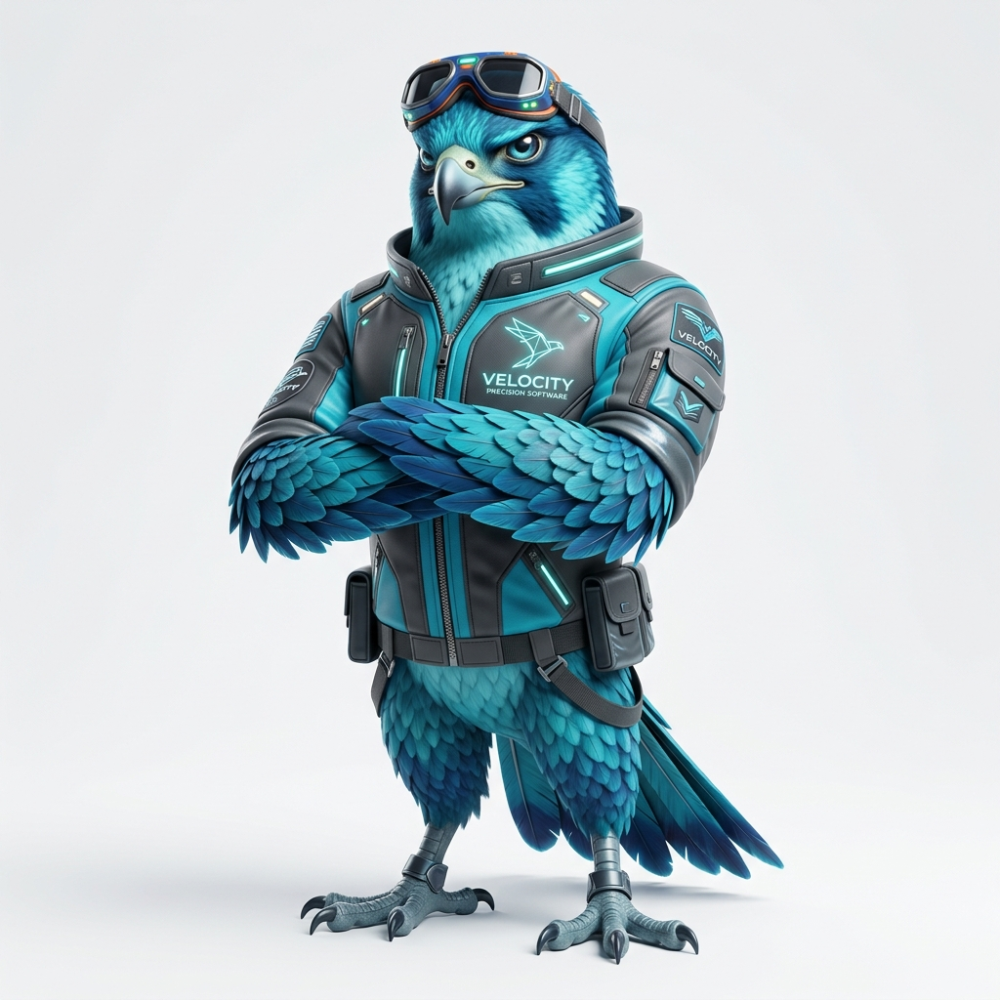

<p align="center">
  
</p>

<h1 align="center">Falcon DM</h1>

<p align="center">
  <strong>macOS download manager — multi-thread HTTP, HLS, YouTube, browser capture.</strong><br>
  Tauri v2 (Rust) backend + React/TypeScript UI. Local-only: no telemetry, no cloud queue.
</p>

<p align="center">
  <a href="https://github.com/batu3384/falcon-dm/actions/workflows/ci.yml"></a>
  <a href="https://github.com/batu3384/falcon-dm/actions/workflows/release.yml"></a>
  
  
</p>

<br>

<table align="center" border="0" cellpadding="0" cellspacing="0">
  <tr>
    <td width="50%" align="center" valign="middle">
      
    </td>
    <td width="50%" valign="middle" style="padding-left: 20px;">
      <h3>Meet Falco (The Sniffer)</h3>
      <p>The mascot reflects what the stack actually does:</p>
      <ul>
        <li><strong>Speed:</strong> DNS-pinned HTTP streaming with bounded redirects.</li>
        <li><strong>Precision:</strong> HLS segment assembly + <code>ffmpeg</code> merge.</li>
        <li><strong>Capture:</strong> Chrome MV3 extension → authenticated localhost API.</li>
      </ul>
    </td>
  </tr>
</table>

---

## Features

| Area | What you get |
|------|----------------|
| **HTTP(S)** | Multi-connection range downloads, byte-exact resume after pause/crash/restart, DNS-pinned streaming, speed limit, proxy, scheduler windows |
| **HLS (m3u8)** | Parallel segment fetch with resume, speed limit, proxy, ffmpeg mux; complex playlists handed to yt-dlp |
| **YouTube** | Watch URL + `yt-dlp` (optional browser cookies, global proxy/speed limit, custom binary path) |
| **Browser extension** | Download capture, offline fallback control, video quality picker, link grabber (batch ≤100) |
| **Desktop UI** | macOS-native shell, inspector panel, speed graph, EN/TR i18n, category paths, release update check |
| **Security** | 6-digit code pairing, SSRF URL block, token + Origin allowlist |

## Core Architecture

### Download engine

HTTP(S) downloads run in the Rust engine over DNS-pinned connections. The file is preallocated as one hidden `.falcon.part` file and split into one byte range per connection; every connection writes at its own offset, an idle connection takes over half of the largest remaining range, and per-range progress is saved next to the file (`.falcon.state`). Pause, crash, automatic retry and app restart all continue exactly where each connection stopped; a changed remote file (ETag / Last-Modified via `If-Range`) restarts cleanly instead of mixing versions. Transient failures (timeouts, 5xx, 429) are retried with backoff up to five times; a run that moves data resets the budget. One global token bucket enforces the speed limit across all downloads and applies to running ones immediately. Finished files are moved into place without overwriting (`name (1).ext` on a clash). Private targets, unsafe redirects, and magnet URLs are rejected.

### Stream pipeline (HLS + YouTube)

- **HLS:** Rust downloads MPEG-TS segments concurrently (proxy + speed limit from Settings); each segment is written to `*.tmp` and renamed when complete, so resume never trusts half a segment; `ffmpeg` remuxes to MP4. Encrypted, fMP4, byte-range and split-audio playlists are handed to yt-dlp; live playlists are refused instead of saving a few seconds.
- **YouTube:** CDN (<code>googlevideo</code>) URLs are rewritten to watch URLs; <code>yt-dlp</code> runs as an external tool (PATH or **Settings → yt-dlp path**). Global **proxy** and **speed limit** apply; browser cookies are **opt-in** (**Settings → Use browser cookies for yt-dlp**). Not bundled.

### Queue & persistence

`QueueManager` ticks every 500ms, bounds concurrency with atomics, and cancels in-flight stream jobs via `tokio::sync::watch`. State lives in SQLite (`rusqlite`) with crash-safe recovery.

### Local API (browser extension)

Axum serves `http://127.0.0.1:14201`:

| Endpoint | Purpose |
|----------|---------|
| `GET /api/health` | Liveness (loopback, no token, `protocol: 2`) |
| `POST /api/pair` | Extension pairing by 6-digit code (`200` token or `202` pending approval) |
| `POST /api/ping` | Authenticated liveness for a paired extension |
| `GET /api/downloads` | Live download rows for the popup |
| `POST /api/intercept` | Media / captured browser download |
| `POST /api/add` | Direct URL (e.g. grabber batch) |
| `POST /api/upload` | Blob media (32 MB cap) |

Mutating requests require `X-Falcon-Token` and a `chrome-extension://` or Edge `Origin` on the allowlist. `GET /api/health` is unauthenticated on loopback. See [extension/README.md](extension/README.md).

## Build requirements

- macOS 13.0+ (Ventura or later)
- **Node.js 22+** (matches CI; Node 24 breaks Vitest/jsdom on GitHub Actions)
- **Rust** stable (`rustup`)
- **Tauri CLI:** `npm install` (devDependency) or `cargo install tauri-cli`
- **Homebrew:** `brew install ffmpeg yt-dlp`

## Compilation & bootstrapping

Sidecars are **not** committed (`.gitignore`). Local provisioning is explicitly unsigned/unverified unless hashes are supplied:

```bash
./scripts/provision-sidecars.sh
```

Copies `ffmpeg` (Homebrew on arm64, pinned static build on Intel) into
`src-tauri/binaries/` as `ffmpeg-<triple>`. Idempotent. Remote provisioning
requires `FFMPEG_SHA256` and verifies the extracted binary before installation:

```bash
ARCH=x86_64 \
FFMPEG_URL='https://example.invalid/immutable-ffmpeg.zip' \
FFMPEG_SHA256='<64-hex SHA-256 of extracted ffmpeg>' \
./scripts/provision-sidecars.sh
```

Release workflows set `RELEASE_MODE=1` and require an immutable `FFMPEG_URL`
and `FFMPEG_SHA256`; missing values fail before any binary is used.
Signed releases also import the Apple certificate into an ephemeral runner
keychain before Tauri build. If no signing secrets are configured, the workflow
selects the explicit unsigned fallback.

Never use an unpinned remote URL in release automation. Release jobs also
publish architecture-specific checksums for the app and its sidecar.
Configure repository variables `FFMPEG_URL` and `FFMPEG_SHA256` before creating
an Intel release; missing values intentionally fail the release instead of
installing an unverifiable remote binary.

```bash
npm install
npm run tauri dev      # development
npm run tauri build    # .app / .dmg (see release.yml for signed builds)
```

### Browser extension

1. Chrome/Edge → `chrome://extensions` → enable **Developer mode** → **Load unpacked** → `extension/`
2. Click the extension icon. It shows a 6-digit code and Falcon DM asks to connect.
3. Check that Falcon DM shows the same code and click **Approve**. Connected extensions are listed (and can be disconnected) in **Settings → Extension**.
4. Extension popup: the **Send browser downloads to Falcon DM** switch controls capture. Options → **Let Chrome download when Falcon DM is closed** restores the browser fallback; by default a captured download is blocked when the app cannot take it.
5. YouTube: install `yt-dlp`; optional custom binary path and cookie opt-in in Settings
6. **Updates:** Settings → **Check for Updates** compares against GitHub Releases (opens release page when newer)
7. **Wake deep link:** `falcondm://wake` only (no download params — avoids token-in-url leaks). Extension wakes app then uses HTTP API. `tauri dev` may not register the URL scheme.

## Development & contributing

Details: [CONTRIBUTING.md](CONTRIBUTING.md). Security issues: [SECURITY.md](SECURITY.md) (no public issues for vulns). Extended docs: [Wiki](https://github.com/batu3384/falcon-dm/wiki) (source in [`wiki/`](wiki/)).

```bash
# Frontend
npm run lint && npm run format:check && npm run test && npm run build
node extension/smoke-test.mjs && node extension/flow-test.mjs

# Backend (src-tauri/)
cargo fmt --all --check
cargo clippy --workspace --all-targets -- -D warnings
cargo test --workspace
```

CI on `main` (protected branch) runs: Frontend lint/test/build, Rust fmt/clippy/test/build on macOS arm64, and `cargo deny` supply-chain audit. Intel builds are validated in the **Release** workflow (`release.yml`).

## Security posture

- **Extension trust:** No silent auto-pair; the user compares a 6-digit code shown in the extension and in the app and approves it. Declined codes stay declined for ten minutes; disconnecting an extension rotates the token. API token is a per-install UUID. Captured downloads are **blocked by default** when Falcon cannot take them; the browser fallback is opt-in in the extension options.
- **Network boundary:** Download URLs validated (no `file://`, loopback, or private IP SSRF). Local API binds `127.0.0.1` only.
- **Deep links:** `falcondm://wake` only — enqueue happens over authenticated HTTP, not query strings.
- **Process isolation:** The only external programs are the bundled `ffmpeg` and the user's `yt-dlp`, started with fixed argument lists (the URL always follows `--`).
- **Data:** No telemetry. Session cookies stay in backend storage, are never
  serialized into frontend download payloads, and are cleared on terminal
  download states. yt-dlp uses browser cookies only when explicitly enabled in Settings.

## License

MIT — see [LICENSE](LICENSE).
